# Лабораторная П06. Роли Ansible и CI на GitHub Actions

## Файлы репозитория
- `roles/nginx_vhosts/`: роль (`tasks`, `handlers`, `templates`)
- `playbook.yml`: плейбук, использующий роль
- `inventory.ini`: инвентарь
- `run_playbook.sh`: скрипт запуска плейбука
- `.github/workflows/`: сценарии GitHub Actions
- `screenshots/`: скриншоты

# Часть 1. Роль nginx_vhosts

## 1. Структура роли
```text
.
├── inventory.ini
├── playbook.yml
├── run_playbook.sh
└── roles
    └── nginx_vhosts
        ├── handlers
        │   └── main.yml
        ├── tasks
        │   └── main.yml
        └── templates
            ├── index.html.j2
            └── site.conf.j2
```

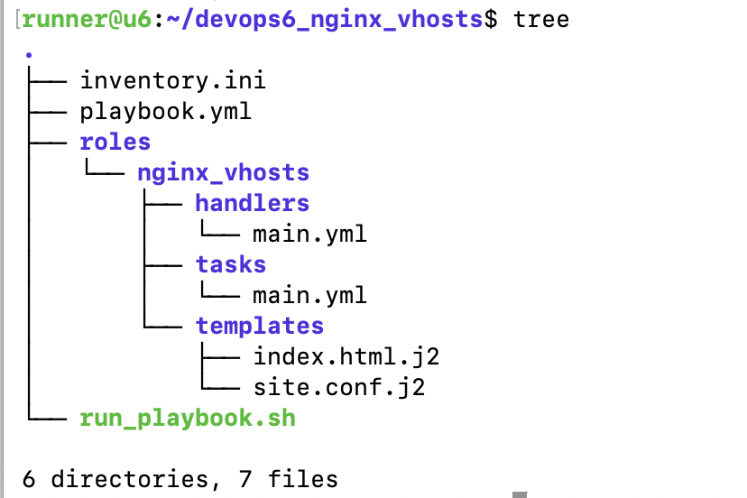

## 2. Содержимое роли

**tasks/main.yml**: установка nginx, создание каталогов сайтов, копирование конфигов и индексных страниц из шаблонов в цикле по списку сайтов. При изменении конфига срабатывает `notify`.
```yaml
---
- name: Install nginx
  ansible.builtin.apt:
    name: nginx
    state: present
    update_cache: true

- name: Create sites folders
  ansible.builtin.file:
    path: "/var/www/{{ item }}/"
    state: directory
    owner: root
    group: root
    mode: "0755"
  loop: "{{ sites }}"

- name: Copy nginx config from template
  ansible.builtin.template:
    src: site.conf.j2
    dest: "/etc/nginx/conf.d/site-{{ item }}.conf"
    owner: root
    group: root
    mode: "0644"
  loop: "{{ sites }}"
  notify: Restart nginx

- name: Copy index from template
  ansible.builtin.template:
    src: index.html.j2
    dest: "/var/www/{{ item }}/index.html"
    owner: root
    group: root
    mode: "0644"
  loop: "{{ sites }}"
```

**handlers/main.yml**: перезапуск nginx (выполняется только после изменения конфигов, поэтому идемпотентно).
```yaml
---
- name: Restart nginx
  ansible.builtin.systemd:
    name: nginx
    state: restarted
```

**templates/site.conf.j2**:
```nginx
server {
        listen 80;
        listen [::]:80;

        root /var/www/{{ item }}/;
        index index.html;

        server_name {{ item }};

        location / {
                try_files $uri $uri/ =404;
        }
}
```

**templates/index.html.j2**:
```html
<HTML>
  <BODY>
    Hello! Site: {{ item }}
  </BODY>
</HTML>
```

## 3. Плейбук и инвентарь
Список виртуальных сайтов задаётся переменной `sites` в плейбуке (параметр роли).

**playbook.yml**
```yaml
---
- name: Install nginx with Virtual Hosts
  hosts: webservers
  remote_user: runner
  become: true
  become_method: ansible.builtin.sudo
  gather_facts: false

  vars:
    sites:
      - "etis.com"
      - "fizfak.com"
      - "mehmat.ru"

  roles:
    - nginx_vhosts
```

**inventory.ini**
```ini
[webservers]
10.10.10.16
```

**run_playbook.sh**
```bash
#!/bin/bash
ansible-playbook ./playbook.yml -i ./inventory.ini --diff
```

## 4. Запуск роли
Первый запуск: созданы каталоги сайтов, скопированы конфиги и индексные страницы, затем nginx перезапущен обработчиком (`ok=5, changed=4, failed=0`). Ключ `--diff` показывает, какие изменения внесены.

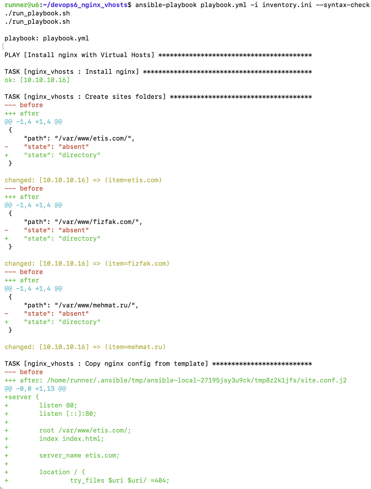

Повторный запуск не вносит изменений (`changed=0`), обработчик не вызывается: роль идемпотентна.

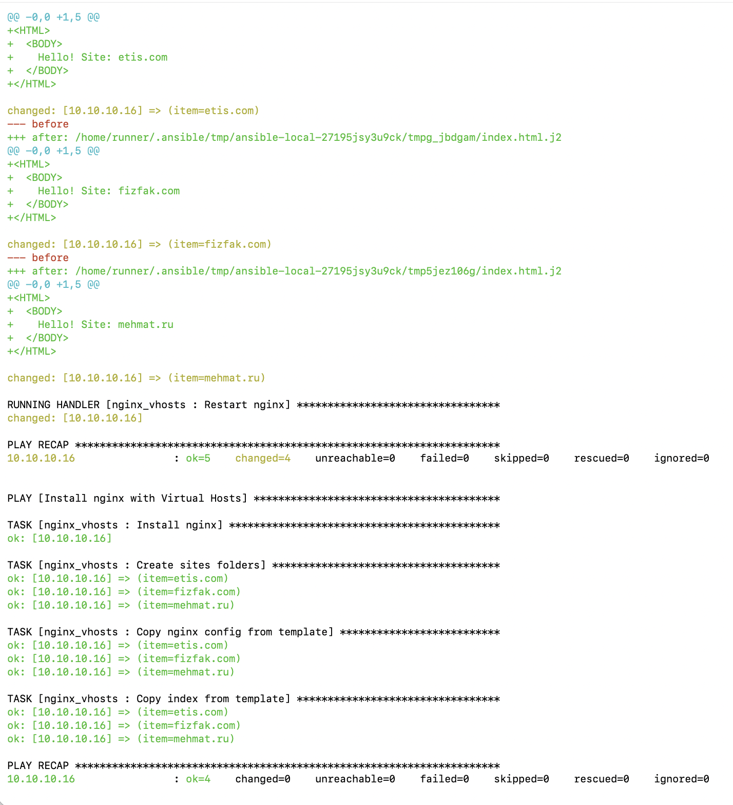

## 5. Проверка виртуальных хостов
Запросы к одному и тому же IP-адресу с разными заголовками `Host`: каждый виртуальный сайт отдаёт свою страницу.

```bash
curl 10.10.10.16 -H 'Host: fizfak.com'
curl 10.10.10.16 -H 'Host: mehmat.ru'
curl 10.10.10.16 -H 'Host: etis.com'
```

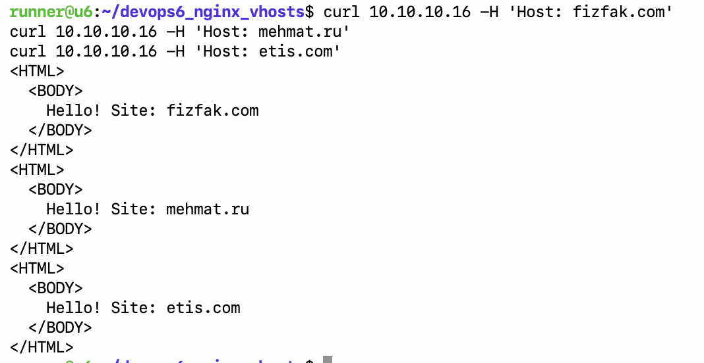

Для проверки по имени в `/etc/hosts` на VM-1 добавлена строка `10.10.10.16 etis.com fizfak.com mehmat.ru`, после чего `curl fizfak.com` возвращает страницу сайта.

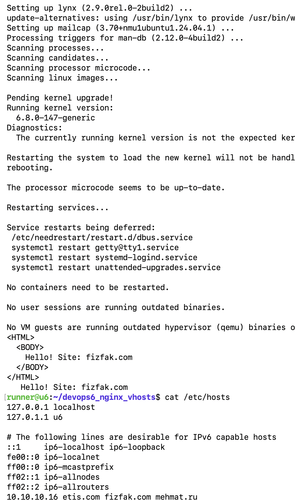

# Часть 2. Непрерывная интеграция (GitHub Actions)

## 6. Репозиторий и доступ по SSH
Создан репозиторий `lab_ansible_roles` (публичный, чтобы можно было использовать Actions). На VM-1 для пользователя `runner` создан отдельный ключ ed25519 для GitHub, его публичная часть добавлена в профиль (Settings → SSH and GPG keys, тип Authentication Key), для хоста `github.com` указан файл ключа в `~/.ssh/config`. Приватный ключ нигде не публикуется. Проверка входа:


## 7. Клонирование и перенос файлов
Репозиторий склонирован на VM-1 командой `git clone`, в него скопированы все файлы первой части (плейбук, роль, инвентарь, скрипт запуска) и отправлены на GitHub (`git add`, `git commit`, `git push`).

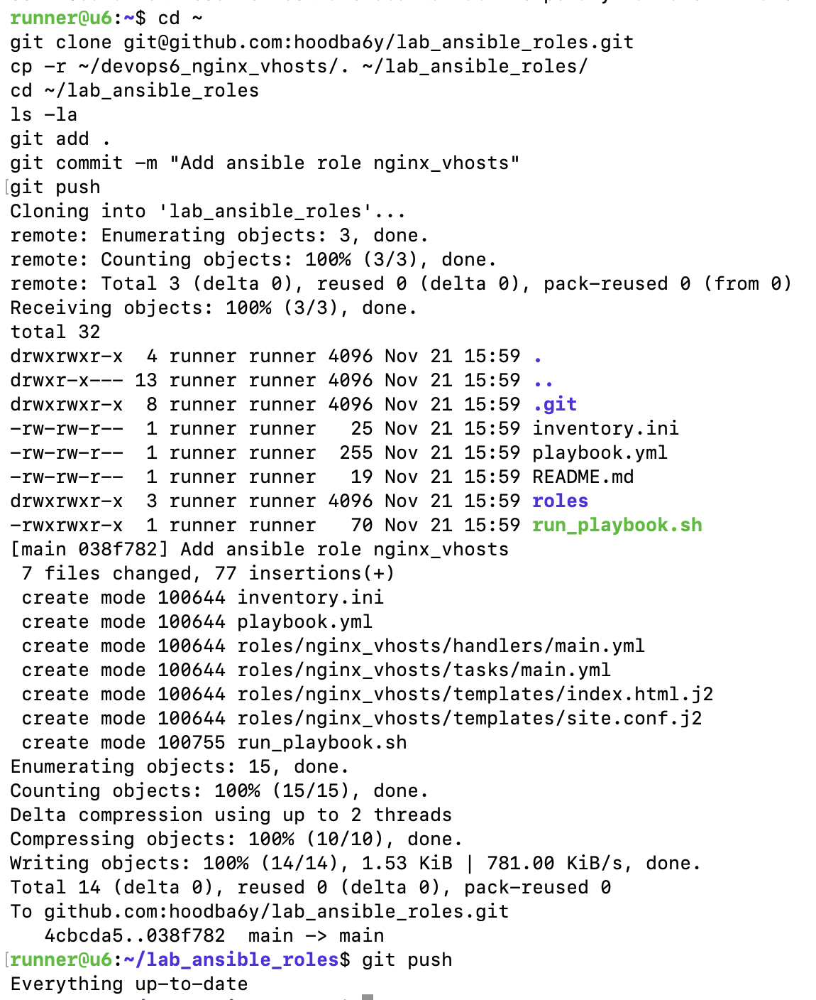

## 8. Тестовый сценарий
Файл `.github/workflows/devops_course_pipeline.yml` запускается на каждое событие `push`. На стороне GitHub он выполняет несколько команд на виртуальной машине-раннере (`ubuntu-latest`), чтобы показать, как работает раннер:

```yaml
name: Github Actions DevOps course
on: push
jobs:
  DevOps-Course-first-job:
    runs-on: ubuntu-latest
    steps:
      - run: echo "I run my first Github Actions"
      - name: Show uptime
        run: uptime
      - name: Where am I?
        run: pwd
      - name: Who am I?
        run: whoami
```

Сценарий запустился сразу после `git push` и завершился успешно. На вкладке Actions видны запуски (на скриншоте уже и запуск линтера, о нём ниже):

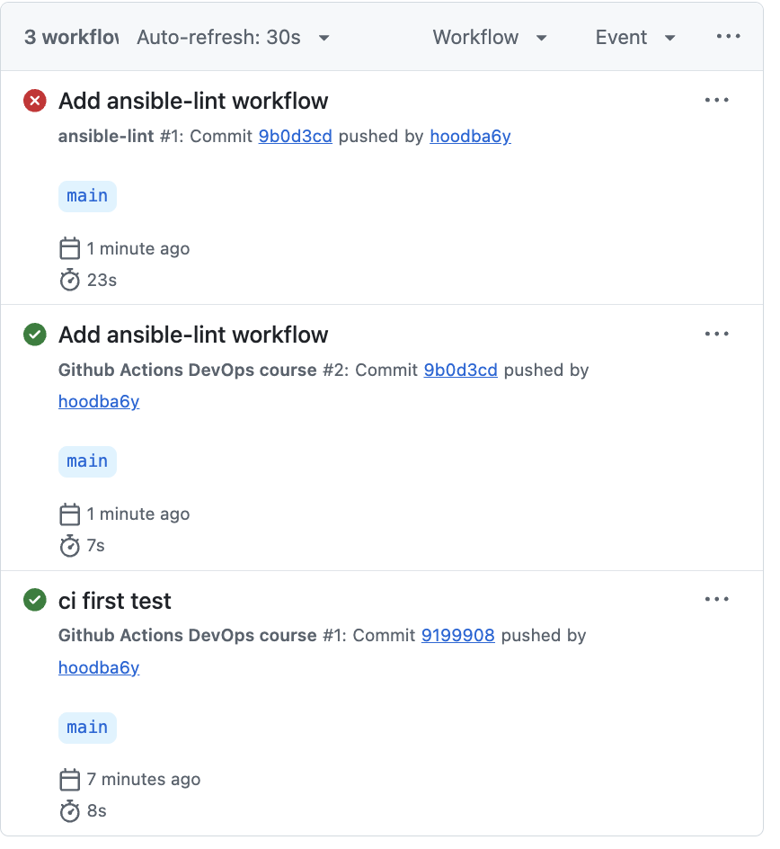

Вывод шагов задачи (время работы раннера, рабочий каталог, пользователь):

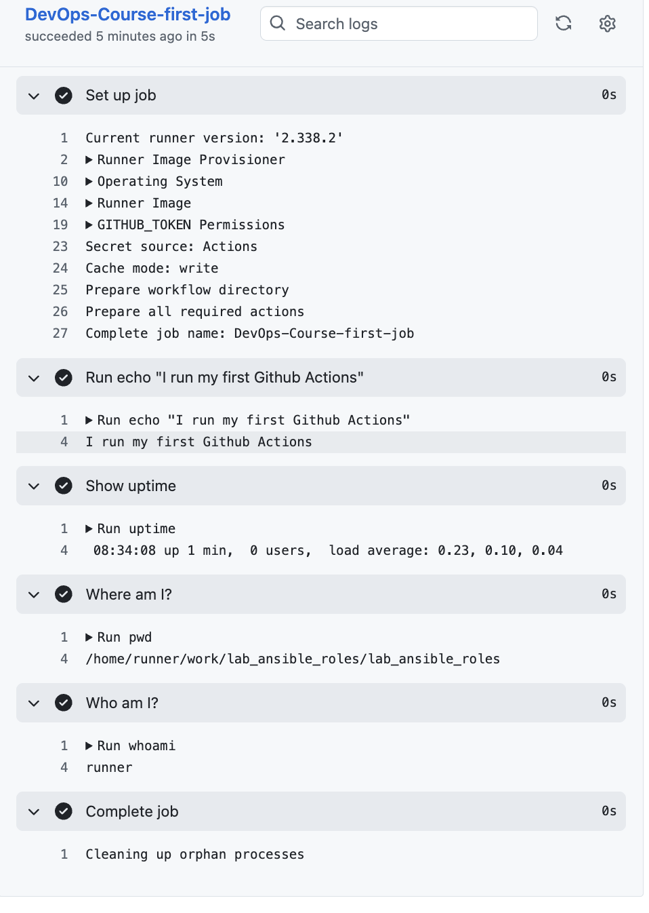

## 9. Боевой сценарий: ansible-lint
Файл `.github/workflows/lint.yml` запускает линтер на каждый push в ветку `main`: скачивает репозиторий (`actions/checkout`) и проверяет плейбуки и роли (`ansible/ansible-lint`).

```yaml
name: ansible-lint
on:
  push:
    branches: ["main"]
jobs:
  build:
    name: Ansible Lint
    runs-on: ubuntu-24.04
    steps:
      - uses: actions/checkout@v4
      - name: Run ansible-lint
        uses: ansible/ansible-lint@main
```

**Первый запуск завершился ошибкой.** Линтер нашёл нарушение схемы: `schema[playbook]` в `playbook.yml` (строка 6): значение `become_method` должно быть указано полным именем плагина (`ansible.builtin.sudo`), а не `sudo`. Предупреждения об устаревших плагинах вывода (`oneline`, `tree`) относятся к самому Ansible и на результат не влияют.

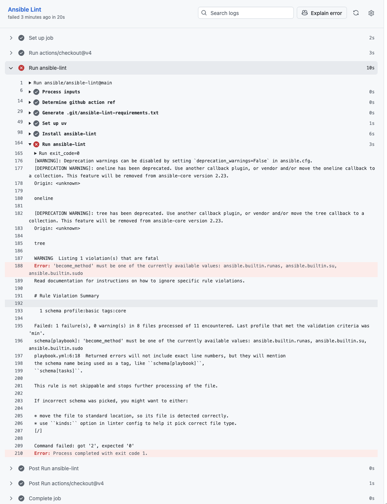

**Исправление:** в `playbook.yml` строка `become_method: sudo` заменена на `become_method: ansible.builtin.sudo`. Плейбук после правки выполняется на VM без ошибок. Изменение отправлено в репозиторий коммитом «Fix ansible-lint: use FQCN for become_method».

**Результат:** новый push автоматически запустил оба сценария, линтер прошёл успешно (зелёная галочка).

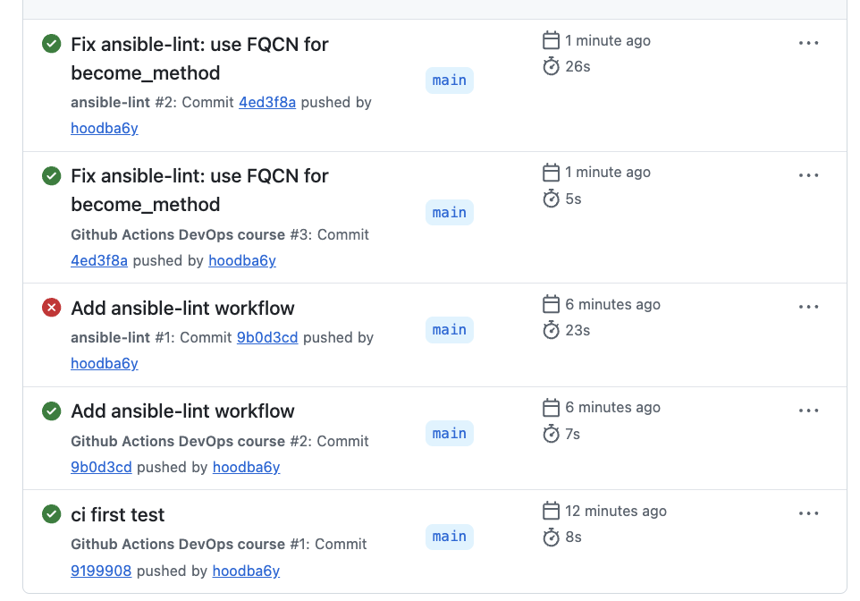

Итоговое состояние репозитория:

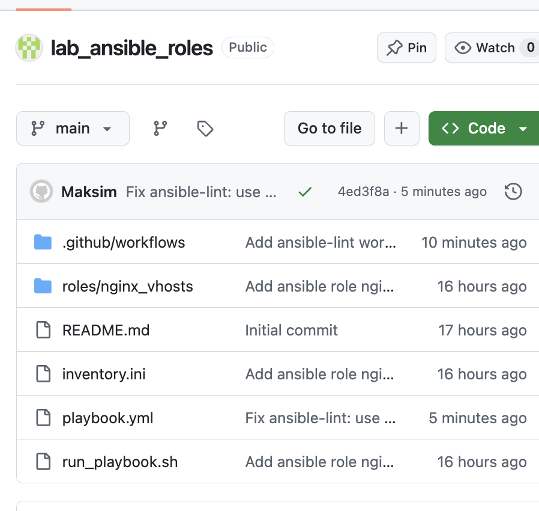

## Выводы
Создана роль Ansible, которая настраивает несколько виртуальных хостов nginx по списку из параметров, роль идемпотентна и проверена с подменой заголовка `Host`. Работа перенесена в репозиторий на GitHub, подключены сценарии GitHub Actions: тестовый (показывает работу раннера) и боевой (`ansible-lint`). Линтер при первом запуске нашёл нарушение схемы, оно исправлено, после чего проверка проходит автоматически при каждом push.
